<div align="center">




[](https://github.com/CarbonOS-Rom)
[](https://t.me/CarbonOSaosp)
[](#license)

**A clean, minimal Android ROM built for speed, stability and personal style.**

</div>

<p align="center"></p>

<a id="getting-started"></a>


**1. Initialize the repo**
```bash
repo init -u https://github.com/CarbonOS-Rom/manifest -b 1.0 --git-lfs
```

**2. Sync the sources**
```bash
repo sync -c --force-sync --optimized-fetch --no-tags --no-clone-bundle --prune -j$(nproc --all)
```

**3. Build**
```bash
. build/envsetup.sh
crystal <devicecodename> userdebug   # or: user
carbon b
```

<p align="center"></p>

<a id="configuration"></a>


Add these to your `device.mk` or `BoardConfig.mk`.

### Essentials

| Flag | Description | Values |
|:-----|:------------|:-------|
| `CARBONOS_MAINTAINER` | Maintainer name shown in the ROM | `"Your Name"` |
| `WITH_GMS` | Include Google Mobile Services | `true` / `false` |

### GMS Variants *(optional)*

| Flag | Description | Default |
|:-----|:------------|:--------|
| `TARGET_USES_MINI_GAPPS` | Minimal GApps package | `false` |
| `TARGET_USES_PICO_GAPPS` | Pico GApps package | `false` |
| `TARGET_DEFAULT_PIXEL_LAUNCHER` | Ship Pixel Launcher as default *(GMS builds only)* | `false` |

> [!NOTE]
> With `WITH_GMS := true` and no variant set, the full GMS package is included.

### Interface

| Flag | Description | Default |
|:-----|:------------|:--------|
| `TARGET_ENABLE_BLUR` | System-wide blur effects | `false` |

### Features

| Flag | Description | Default |
|:-----|:------------|:--------|
| `TARGET_SUPPORTS_QUICK_TAP` | Quick Tap gesture | `false` |
| `BYPASS_CHARGE_SUPPORTED` | Bypass charging | `false` |

<p align="center"></p>

<a id="device-info"></a>


> [!IMPORTANT]
> Coming in a future version.

Fill in the hardware specs shown on the *My device* page:

```properties
ro.carbon.device.name=Poco X3
ro.carbon.display=1080 x 2400, 120 Hz
ro.carbon.screen=6.67" IPS LCD
ro.carbon.soc=Snapdragon® 732G
ro.carbon.platform=SM7150-AC
ro.carbon.battery=6000 mAh
ro.carbon.camera=64MP + 13MP + 2MP
ro.carbon.front=20MP
```

<p align="center"></p>

<a id="example"></a>


> [!WARNING]
> This example still needs testing.

```makefile
# Maintainer
CARBONOS_MAINTAINER := "John Doe"

# GMS (mini)
WITH_GMS := true
TARGET_USES_MINI_GAPPS := true
TARGET_DEFAULT_PIXEL_LAUNCHER := true

# Interface
TARGET_ENABLE_BLUR := true

# Features
TARGET_SUPPORTS_QUICK_TAP := true
BYPASS_CHARGE_SUPPORTED := true
```

<p align="center"></p>

<a id="contributing"></a>


Contributions are welcome — open a pull request on the relevant repo.

**Want to maintain CarbonOS for your device?** Read the [maintainer requirements](https://github.com/CarbonOS-Rom/maintainership/issues/new/choose) and apply.

<p align="center"></p>

<a id="credits"></a>


CarbonOS stands on the work of these projects:

<div align="center">

| [<br>**LineageOS**](https://github.com/LineageOS) | [<br>**RisingOS Revived**](https://github.com/RisingOS-Revived) | [<br>**YAAP**](https://github.com/Yaap) | [<br>**crDroid**](https://github.com/crdroidandroid) | [<br>**Evolution X**](https://github.com/Evolution-X) |
|:---:|:---:|:---:|:---:|:---:|
| [<br>**The Parasite Project**](https://github.com/TheParasiteProject) | [<br>**PixelExperience**](https://github.com/PixelExperience) | [<br>**PixelOS**](https://github.com/pixelos-aosp) | [<br>**DerpFest**](https://github.com/DerpFest-AOSP) | [<br>**SuperiorOS**](https://github.com/superioros) |
| [<br>**Project Awaken**](https://github.com/Project-Awaken) | [<br>**AxionOS**](https://github.com/AxionAOSP) | [<br>**MistOS**](https://github.com/Project-Mist-OS) | | |

*…and everyone else who keeps custom ROM development alive.*

</div>

<p align="center"></p>

<div align="center">

<a id="license"></a>


```
Copyright (C) 2026 CarbonOS

Licensed under the Apache License, Version 2.0
```


</div>
